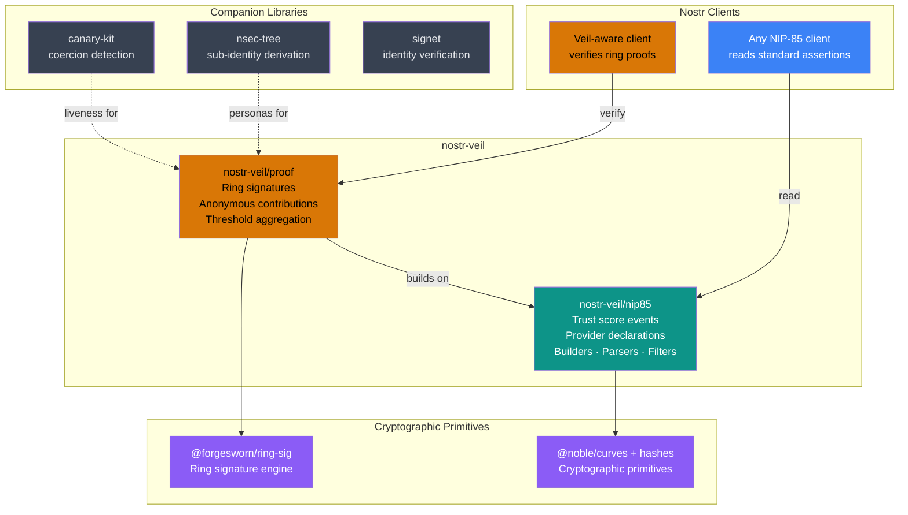

# nostr-veil

[](https://github.com/forgesworn/nostr-veil/actions/workflows/ci.yml)
[](https://www.npmjs.com/package/nostr-veil)
[](./LICENCE)
[](https://github.com/sponsors/TheCryptoDonkey)

**Trust scores you can verify without seeing who contributed them.**

A privacy layer for Nostr reputation systems. A group of people can collectively score someone's trustworthiness, and anyone can verify the result -- but nobody can tell which group members actually contributed. Built for abuse reporting, whistleblowing, journalism, and anonymous peer review.

**New here?** The [**use-case overview**](https://veil.forgesworn.dev/use-cases/) covers what nostr-veil is, the problem it solves, and practical things you can build on it today.

---

## Key concepts

If you're new to this space, here's what the jargon means:

| Term | Plain English |
|------|--------------|
| **Web of Trust (WoT)** | Instead of a central authority deciding who's trustworthy, people vouch for each other. Your reputation is built from the opinions of people who know you. |
| **NIP-85** | A [Nostr standard](https://github.com/nostr-protocol/nips/blob/master/85.md) for publishing trust scores (e.g. "this person has 800 followers and a rank of 74"). Think of it as a shared format for reputation data. |
| **Ring signature** | A cryptographic technique where someone signs a message on behalf of a group. A verifier can confirm "someone in this group signed this" but cannot tell who. Like a sealed ballot -- you can count the votes but not trace them. |
| **LSAG** | Linkable Spontaneous Anonymous Group signature -- a specific type of ring signature that also detects duplicates. If the same person tries to vote twice, the system catches it, without revealing who they are. |
| **Trust circle** | The group of people who collectively produce a trust score. Each member contributes anonymously; the results are combined (median by default). |

---

## The trust trilemma

Today's Nostr trust scores (NIP-85) ask you to pick two:

| Property    | Standard NIP-85 | With nostr-veil |
|-------------|:---:|:---:|
| Verifiable  | ✓   | ✓  |
| Private     | ✗   | ✓  |
| Portable    | ✓   | ✓  |

Anyone who can see an ordinary score can see who published it, and multi-party reputation usually creates a visible contributor graph. That works fine for benign social signals. It fails the moment the subject matter is sensitive -- abuse reporting, whistleblowing, political dissent. The people who need reputation systems most are the ones who cannot afford to be identified.

nostr-veil solves all three for group assertions. The output is a standard NIP-85 event that NIP-85-aware apps can display. Apps that understand nostr-veil can go further and verify the cryptographic proofs that back the scores.

---

## Architecture



---

## Quick start

```
npm install nostr-veil
```

```ts
import { schnorr } from '@noble/curves/secp256k1.js'
import { bytesToHex } from '@noble/hashes/utils.js'
import {
  createTrustCircle, contributeAssertion, aggregateContributions, verifyProof, signEvent, NIP85_KINDS,
} from 'nostr-veil'

// 0. Generate keys. nostr-veil takes 64-char lowercase hex strings everywhere.
function generateKeypair() {
  const secret = schnorr.utils.randomSecretKey()            // Uint8Array (noble v2)
  return { privkey: bytesToHex(secret), pubkey: bytesToHex(schnorr.getPublicKey(secret)) }
}
const alice = generateKeypair()
const bob = generateKeypair()
const carol = generateKeypair()
const subject = generateKeypair()      // the account being scored; only its pubkey is used
const aggregator = generateKeypair()   // publishes the result; does not need to be a circle member
const subjectPubkey = subject.pubkey

// 1. Define the circle (three anonymous members)
const circle = createTrustCircle([alice.pubkey, bob.pubkey, carol.pubkey])

// 2. Each member contributes independently -- their identity is hidden inside the ring
const aliceContribution = contributeAssertion(
  circle, subjectPubkey, { followers: 820, rank: 74 }, alice.privkey, circle.members.indexOf(alice.pubkey),
)
const bobContribution = contributeAssertion(
  circle, subjectPubkey, { followers: 900, rank: 80 }, bob.privkey, circle.members.indexOf(bob.pubkey),
)

// 3. Aggregate into a standard NIP-85 kind 30382 user assertion (an unsigned EventTemplate)
const assertion = aggregateContributions(circle, subjectPubkey, [aliceContribution, bobContribution])

// 4. The aggregator signs it as an ordinary Nostr event and publishes it
const signed = signEvent(assertion, aggregator.privkey)

// 5. Any client verifies -- two distinct members agreed, no names attached
const result = verifyProof(signed, { expectedKind: NIP85_KINDS.USER })
// { valid: true, circleSize: 3, threshold: 2, distinctSigners: 2, errors: [] }
```

The `@noble/curves` and `@noble/hashes` imports are only used for key generation; nostr-veil already depends on both, so install them directly if your package manager does not hoist them.

**Formats.** Pubkeys (circle members, subjects, bundle signers) are 64-char lowercase hex x-only strings. Every `privateKey` argument (`contributeAssertion`, `signEvent`, `createSignedDeploymentBundle`) is a 64-char hex string. A `Uint8Array` is rejected (for example `ValidationError: privateKey must be a string`), so convert noble's byte keys with `bytesToHex` as above.

**Important:** `memberIndex` must match the member's position in the *sorted* pubkey array. `createTrustCircle` sorts pubkeys lexicographically -- the index you pass to `contributeAssertion` must reflect that sorted order, not the order you passed to `createTrustCircle`. Always use `circle.members.indexOf(myPubkey)`. A wrong index throws `Private key does not match ring member at signerIndex`.

**Who signs what.** The ring signatures live in the `veil-sig` tags. The outer Nostr signature from `signEvent` is made by the aggregator, the party that collects the contributions and publishes the event. Any Nostr key will do and it need not belong to a circle member. `verifyProof` checks the ring proofs only; use `verifySignedEvent(event)` to check the outer id and signature after fetching an event from an untrusted relay.

Passing `expectedKind` matters because v1 proofs are not bound to the event kind; see [Proof v2](#proof-v2).

---

## API reference

### `nostr-veil/nip85` -- NIP-85 foundation

| Export | Description |
|--------|-------------|
| `buildUserAssertion(pubkey, metrics)` | Build a NIP-85 kind 30382 user assertion event template |
| `buildEventAssertion(eventId, metrics)` | Build a NIP-85 kind 30383 event assertion |
| `buildAddressableAssertion(address, metrics)` | Build a NIP-85 kind 30384 addressable event assertion |
| `buildIdentifierAssertion(identifier, kTag, metrics)` | Build a NIP-85 kind 30385 NIP-73/external identifier assertion |
| `buildProviderDeclaration(providers, encryptedContent?)` | Build a NIP-85 kind 10040 trusted service provider declaration |
| `parseAssertion(event)` | Parse a raw event into a `ParsedAssertion` |
| `parseProviderDeclaration(event, decryptFn?)` | Parse a kind 10040 provider declaration into `ParsedProvider[]` (supports optional NIP-44 decryption) |
| `validateAssertion(event, options?)` | Validate a NIP-85 assertion -- pass `{ strict: true }` for kind-specific metric checks and optional subject-hint validation |
| `validateAssertionStrict(event)` | Strict NIP-85 assertion validation shortcut |
| `validateProviderDeclarationStrict(event)` | Strict kind 10040 provider declaration validation for plaintext tags; encrypted declarations are accepted when tags are omitted |
| `assertionFilter({ kind, subject?, provider? })` | Build a relay query filter for assertions |
| `providerFilter(pubkey)` | Build a relay query filter for a provider declaration |
| `NIP85_KINDS`, `describeNip85Kind(kind)` | Kind constants and labels for the [NIP-85](https://nips.nostr.com/85) trusted assertion kinds |

### `nostr-veil/proof` -- Ring-signature proof layer

| Export | Description |
|--------|-------------|
| `createTrustCircle(memberPubkeys, options?)` | Create a trust circle from an array of pubkeys; pass `{ scope }` to federate circles for [cross-circle deduplication](#cross-circle-deduplication) |
| `contributeAssertion(circle, subject, metrics, privateKey, memberIndex, options?)` | Produce an anonymous ring-signed `Contribution`; v1 by default, v2 when `{ proofVersion: 'v2', kind, subjectTag, subjectTagValue }` is supplied |
| `contributeEventAssertion(circle, eventId, metrics, privateKey, memberIndex, options?)` | Produce a contribution for a kind 30383 event assertion |
| `contributeAddressableAssertion(circle, address, metrics, privateKey, memberIndex, options?)` | Produce a contribution for a kind 30384 addressable assertion |
| `contributeIdentifierAssertion(circle, identifier, kTag, metrics, privateKey, memberIndex, options?)` | Produce a contribution for a kind 30385 identifier assertion |
| `aggregateContributions(circle, subject, contributions, options?)` | Aggregate user-score contributions into a kind 30382 NIP-85 event with veil tags (default aggregation: median) |
| `aggregateEventContributions(circle, eventId, contributions, options?)` | Aggregate into a kind 30383 event assertion with `d`/`e` tags |
| `aggregateAddressableContributions(circle, address, contributions, options?)` | Aggregate into a kind 30384 addressable assertion with `d`/`a` tags |
| `aggregateIdentifierContributions(circle, identifier, kTag, contributions, options?)` | Aggregate into a kind 30385 identifier assertion with `d`/`k` tags |
| `verifyProof(event, options?)` | Verify ring signatures, threshold metadata, signed metric aggregation, and optional proof-version (`requireProofVersion`) and kind (`expectedKind`) requirements |
| `verifyFederation(events, options?)` | Verify several scoped events together and count distinct contributors across circles ([cross-circle deduplication](#cross-circle-deduplication)) |
| `canonicalMessage(circleId, subject, metrics)` | Compute the canonical message signed by contributors |
| `canonicalMessageV2(circleId, subject, metrics, context)` | Compute the opt-in v2 canonical message that binds kind and subject hint tag |
| `computeCircleId(sortedPubkeys)` | Compute the deterministic circle ID (SHA-256 of colon-joined pubkeys) |

### `nostr-veil/profiles` -- safer deployment profiles

| Export | Description |
|--------|-------------|
| `USE_CASE_PROFILES` | Built-in machine-readable profiles for the documented use cases, including proof claims, limitations, required controls, and recommended actions |
| `USE_CASE_PROFILE_BY_ID` | Lookup table keyed by use-case slug |
| `validateUseCaseProfileDefinition(profile)` | Check custom profiles for NIP-85 route mismatches, unsupported metrics, missing safety metadata, and overclaiming warnings before production use |
| `verifyUseCaseProfile(events, profile, options)` | Verify NIP-85 syntax, proof v2, subject binding, threshold, freshness, accepted circles, and federation policy |
| `createCircleManifest(options)` | Build a machine-readable circle manifest with member list, allowed profiles, expiry, revocation, and supersession metadata |
| `verifyCircleManifest(manifest, options?)` | Verify that a circle manifest matches its members and deployment constraints |
| `createDeploymentPolicy(profile, options)` | Build a fail-closed deployment policy with accepted circles, expected subject, metric bounds, freshness, threshold, signature requirements, and optional companion evidence requirements |
| `verifyDeploymentPolicy(events, policy, options?)` | Verify a profile plus deployment-specific controls and supplied companion evidence before acting on a score |
| `createSignedDeploymentBundle(policy, options)` | Sign a deployment policy and its manifests as trusted operator configuration |
| `verifySignedDeploymentBundle(bundle, options?)` | Verify only the bundle: shape, expiry and future-`issuedAt` against `now`, the signer's BIP-340 signature, and `trustedPublishers`. Does not look at any events |
| `verifyDeploymentBundle(events, bundle, options?)` | Verify a signed bundle from trusted publishers, then verify the bundled deployment policy |
| `verifyProductionDeployment(events, bundle, options?)` | One-call production gate that also requires an expiring bundle and signed relay-fetched events by default |
| `createProductionDecisionReport(result)`, `verifyProductionDeploymentReport(events, bundle, options?)` | Produce an audit/UI-ready decision report with recommended action, issue remediation, and control status |
| `createAdmissionChallenge(options)`, `createAdmissionPresentation(challenge, privateKey, options?)` | Build and sign a pubkey-bound relay/community admission challenge outside the NIP-85 assertion |
| `verifyAdmissionPresentation(presentation, challenge, options?)`, `verifyAdmissionRequest(events, bundle, challenge, presentation, options?)` | Verify the admission handshake plus the existing signed kind 30382 vouch and deployment bundle |
| `VerificationIssue`, `VerificationIssueCode` | Stable machine-readable issue codes returned alongside human-readable errors |
| `explainVerificationIssue(issueOrCode)`, `remediationForIssue(issueOrCode)` | Turn stable issue codes into concrete operator or verifier remediation guidance |
| `CompanionEvidence`, `CompanionEvidenceRequirement` | Types for external resolver, provenance, service, and list checks that a deployment policy can require alongside the cryptographic proof |
| `packageReleaseCompanionEvidenceRequirements(subject)`, `collectPackageReleaseCompanionEvidence(options)`, `resolvePackageReleaseCompanionEvidence(options)` | Require package provenance, SBOM, and vulnerability-feed evidence; collect from registry/SBOM/OSV-style observations or resolve already-collected observations |
| `nip05DomainCompanionEvidenceRequirements(subject)`, `collectNip05DomainCompanionEvidence(options)`, `resolveNip05DomainCompanionEvidence(options)` | Require NIP-05 resolution, HTTPS probe, and DNS-owner evidence; collect from NIP-05/HTTPS/DNS observations or resolve already-collected observations |
| `listLabelerCompanionEvidenceRequirements(subject)`, `collectListLabelerCompanionEvidence(options)`, `resolveListLabelerCompanionEvidence(options)` | Require list revision, sample-review, and correction-channel evidence; collect from relay/list/correction observations or resolve already-collected observations |
| `fetchNpmPackageVersionEvidence()`, `fetchOsvVulnerabilityReport()`, `normaliseSbomEvidence()`, `fetchNip05DocumentEvidence()`, `probeHttpsService()`, `fetchAddressableEventFromRelay()`, `probeCorrectionChannel()` | Lower-level adapters for building custom evidence collection pipelines |
| `canonicalRelaySubject`, `canonicalServiceSubject`, `canonicalNip05Subject`, `canonicalDomainSubject`, `canonicalLnurlpSubject`, `canonicalNip96Subject`, `canonicalNpmPackageSubject`, `canonicalPackageDigestSubject`, `canonicalGitRepositorySubject`, `canonicalGithubRepositorySubject`, `canonicalMaintainerSubject` | Canonical subject helpers for common real-world identifiers |
| `canonicalPubkeySubject`, `canonicalEventSubject`, `canonicalAddressSubject` | Canonical subject helpers for Nostr-native subjects |

Freshness checks in `verifyCircleManifest`, `verifySignedDeploymentBundle`, `verifyDeploymentBundle`,
`verifyAdmissionPresentation`, and the verifiers built on them are fail closed:
expiry and future-`issuedAt` checks run against the current time unless you
pass an explicit `now` (intended for tests and historical verification).

The built-in profiles include safety metadata for production UX and agentic
integrations: `proofClaims`, `proofLimitations`, `requiredControls`, and
`recommendedActions`. Use those fields to show what the proof actually supports
and which real-world checks must still happen outside nostr-veil. If you define
a custom profile, run `validateUseCaseProfileDefinition()` in tests or CI before
shipping it; warnings are where the profile may be technically valid but
underspecified for real-world decisions.

Use `companionEvidence` when a supported profile depends on facts outside the
NIP-85 event. For example, package policies can require `npm-provenance`,
`sbom`, and `vulnerability-feed`; provider policies can require
`nip05-resolution`, `https-probe`, and `dns-owner-check`; list policies can
require `list-revision-fetch`, `sample-review`, and `correction-channel`.
Missing, failed, stale, or wrong-subject evidence fails closed without changing
the underlying NIP-85 assertion. Prefer the collector helpers when the library
can fetch or normalise the observation for you, and the resolver helpers when
your application already has registry, service, or list observations from its
own infrastructure. Avoid hand-written `pass` records in production.

### Root export (`nostr-veil`) -- everything, plus signing

The root entry point re-exports all of `nostr-veil/nip85`, `nostr-veil/proof` and `nostr-veil/profiles`, and adds the signing helpers below. One `import ... from 'nostr-veil'` reaches every export in this reference; the subpath exports exist only so you can import a single layer. The signing helpers are available from the root only.

| Export | Description |
|--------|-------------|
| `signEvent(template, privateKey)` | Sign an unsigned event template with BIP-340 Schnorr (`privateKey` is a 64-char hex string) -- returns a complete `SignedEvent` |
| `verifySignedEvent(event)` | Verify a signed Nostr event id and BIP-340 signature after fetching from an untrusted relay |
| `computeEventId(event)` | Compute the NIP-01 event ID (SHA-256 of canonical serialisation) |

### Options and types

**Metrics.** Contributions take `Record<string, number>`. Values must be finite (`NaN` and `Infinity` throw `Metric "<key>" must be a finite number`); integers are not required, and the published tag is `String(value)`. Metric names must not be a single character, start with `veil-`, be a Nostr tag with its own meaning (`expiration`, `alt`, `client`, `nonce`, `content-warning`), or be `__proto__`: contributing throws `Metric name "<name>" is reserved: ...`, aggregation rejects such a contribution, and `verifyProof` rejects an event whose signed metrics use one. This stops a single circle member from injecting a tag such as `expiration` into the published event. The publisher can still set a NIP-40 expiration or a NIP-31 alt on the event it signs: pass `{ expiration, alt }` to the aggregator. The circle does not sign these two tags; the publisher's own Nostr signature covers them, as it covers `content`. By default `verifyProof` accepts at most 128 metrics per signed message and names up to 64 characters. The `nostr-veil/nip85` builders take typed metrics instead (all fields optional): `UserMetrics` (kind 30382: `followers`, `rank`, `first_created_at`, `post_cnt`, `reply_cnt`, `reactions_cnt`, `zap_amt_recd`, `zap_amt_sent`, `zap_cnt_recd`, `zap_cnt_sent`, `zap_avg_amt_day_recd`, `zap_avg_amt_day_sent`, `reports_cnt_recd`, `reports_cnt_sent`, `t` (string), `active_hours_start`, `active_hours_end`), `EventMetrics` (kinds 30383 and 30384: `rank`, `comment_cnt`, `quote_cnt`, `repost_cnt`, `reaction_cnt`, `zap_cnt`, `zap_amount`) and `IdentifierMetrics` (kind 30385: `rank`, `comment_cnt`, `reaction_cnt`).

**Aggregation options.** The `options` argument of `aggregateContributions` and the typed `aggregate*Contributions` helpers is either a bare function `(values: number[]) => number` or an object:

```ts
{
  aggregate?: 'median' | 'mean' | 'sum' | 'min' | 'max'  // built-in, default 'median'
  aggregateFn?: (values: number[]) => number              // custom; ignored if `aggregate` is set
  proofVersion?: 'v1' | 'v2'                              // default 'v1'
  kind?: number                                           // aggregateContributions only; legacy, default 30382
  expiration?: number                                     // NIP-40 expiration tag, unix seconds
  alt?: string                                            // NIP-31 alt tag, non-empty
}
```

`median` and `mean` round to an integer; `sum`, `min` and `max` do not. A non-finite result throws, and an unknown `aggregate` name throws `Unknown aggregate function: <name>`. A built-in name is written to the `veil-agg` tag and `verifyProof` reads it from there, so verifying a summed tally needs no option: `aggregateContributions(circle, subject, contributions, { aggregate: 'sum' })` verifies with a bare `verifyProof(event)`. A custom function is written as `veil-agg: custom` and must be passed to the verifier too (`verifyProof(event, { aggregateFn })` or a bare function), otherwise it fails with `veil-agg is "custom": pass the aggregate function via options to verify the metric tags`.

`expiration` and `alt` are publisher tags: the circle does not sign them, and `verifyProof` does not read them as metrics. `expiration` must be a non-negative safe integer and `alt` a non-empty string, or aggregation throws. `verifyProof` accepts at most one of each, rejects an `expiration` that is not a unix time in seconds, and does not compare it with the clock: relays and clients act on NIP-40 expiry, and a past expiration still verifies, so archived events can be re-checked. Other general tags (`client`, `nonce`, `-`, `L`, `l`, `i`, `content-warning`) are not accepted on veil events, and `verifyProof` reads them as unsigned metrics.

**`verifyProof(event, options?)`.** `options` is a bare aggregate function or an object `{ aggregateFn?, expectedKind?, requireProofVersion?, limits? }`:

| Option | Type | Meaning |
|--------|------|---------|
| `aggregateFn` | `(values: number[]) => number` | Needed only when `veil-agg` is `custom` |
| `expectedKind` | `number` | Reject events of any other NIP-85 kind. Recommended for v1 proofs, which are not kind-bound |
| `requireProofVersion` | `'v1' \| 'v2'` | Reject signatures of the other proof version |
| `limits` | `Partial<VerifyLimits>` | Override `DEFAULT_VERIFY_LIMITS`: `maxRingSize` 1000, `maxSigPayloadBytes` 128000, `maxSignedMessageBytes` 16384, `maxMetricCount` 128, `maxMetricNameLength` 64 |

It returns `{ valid, circleSize, threshold, distinctSigners, errors }`.

**`contributeAssertion` options and `canonicalMessageV2`.** `contributeAssertion(..., options?)` takes `{ proofVersion?: 'v1' | 'v2', kind?: number, subjectTag?: 'p' | 'e' | 'a' | 'k', subjectTagValue?: string }`; for v2 the defaults are kind 30382, tag `p` and the subject itself. The typed helpers (`contributeEventAssertion`, `contributeAddressableAssertion`, `contributeIdentifierAssertion`) take only `{ proofVersion?: 'v1' | 'v2' }` and fill in the kind and tag. `canonicalMessageV2(circleId, subject, metrics, context)` takes `context` as `{ kind, subjectTag, subjectTagValue }`, all required: `kind` a non-negative safe integer, `subjectTag` one of `p`, `e`, `a`, `k`, and `subjectTagValue` a non-empty string.

**NIP-85 parse results.** `parseAssertion(event)` returns `{ kind: number, subject: string, metrics: Record<string, string | number> }`: `subject` is the `d` tag value (empty string if absent) and `metrics` holds every tag except `d`, `p`, `e`, `a`, `k` and `veil-*`; the values are the raw tag strings. `parseProviderDeclaration(event)` returns `ParsedProvider[]`, each `{ kind: number, metric: string, servicePubkey: string, relayHint: string }` (the same shape as the `ProviderEntry` passed to `buildProviderDeclaration`). With a `decryptFn: (ciphertext: string) => Promise<string>` it returns a `Promise<ParsedProvider[]>`.

**Profiles options.** All timestamps are Unix seconds. `now` defaults to the current time wherever it appears.

| Function | Options |
|----------|---------|
| `createCircleManifest(options)` | Required: `issuedAt`, `members`, `name`, `profileIds`, `purpose`. Optional: `expiresAt`, `status` (`'active' \| 'revoked' \| 'superseded'`), `supersedes`, `revokedCircleIds`, `contact`, `evidenceProcess`, `policyUri` |
| `verifyCircleManifest(manifest, options?)` | `allowSuperseded`, `now`, `profileId`, `revokedCircleIds` |
| `createDeploymentPolicy(profile, options)` | Required: `expectedSubject`, plus at least one active circle from `acceptedCircleIds` or `circleManifests`. Optional: `expectedSubjectTagValue`, `id` (default: the profile id), `maxAgeSeconds` and `minDistinctSigners` (default: the profile's), `metricPolicies` (`{ [metric]: { required?, min?, max?, integer? } }`), `rejectUnknownMetrics` (default `false`), `requireNostrSignature` (default `false`), `companionEvidence`, `allowSupersededCircleIds` (default `false`), `now` |
| `createSignedDeploymentBundle(policy, options)` | Required: `id`, `issuedAt`, `privateKey` (hex). Optional: `expiresAt` (must be greater than `issuedAt`). Returns a frozen bundle carrying the `signer` pubkey and `signature` |
| `verifyUseCaseProfile(events, profile, options?)` | `acceptedCircleIds`, `aggregateFn`, `expectedSubject`, `expectedSubjectTagValue`, `maxAgeSeconds`, `minDistinctSigners`, `now`, `requireKnownCircle` (fails when no accepted circle is supplied unless set to `false`) |
| `verifyDeploymentPolicy(events, policy, options?)` | `aggregateFn`, `companionEvidence` (the supplied `CompanionEvidence[]`), `now` |
| `verifySignedDeploymentBundle(bundle, options?)` | `now`, `trustedPublishers` |
| `verifyDeploymentBundle(events, bundle, options?)` | The `verifyDeploymentPolicy` options plus `trustedPublishers` |
| `verifyProductionDeployment(events, bundle, options?)` | The `verifyDeploymentBundle` options plus `requireBundleExpiry` and `requireSignedEvents`, both `true` unless set to `false` |

`trustedPublishers` is effectively required for bundle verification: without at least one valid pubkey it fails with `no trusted bundle publishers configured`. `verifyProductionDeployment` returns the bundle and policy results plus `{ decision: 'accept' | 'reject', valid, errors, issues }`.

### Profiles example

A production verifier pins the operator's publisher pubkey, loads a signed deployment bundle, and checks fetched assertions against it. This continues from the quick start (`alice`, `bob`, `carol`, `circle`, `subjectPubkey`, `aggregator`). The built-in `USER_REPUTATION_ABUSE_REPORTING_PROFILE` (id `user-reputation-abuse-reporting`) requires proof v2, at least three distinct signers, and an assertion no older than 300 seconds, so the contributions below are v2 and all three members sign.

```ts
import {
  USER_REPUTATION_ABUSE_REPORTING_PROFILE,
  createDeploymentPolicy,
  createSignedDeploymentBundle,
  verifyProductionDeployment,
} from 'nostr-veil/profiles'

const operator = generateKeypair() // the deployment operator, separate from circle members

// Three members contribute with proof v2, then the aggregator signs and publishes
const contributions = [alice, bob, carol].map(member => contributeAssertion(
  circle, subjectPubkey, { rank: 80 }, member.privkey, circle.members.indexOf(member.pubkey), { proofVersion: 'v2' },
))
const event = signEvent(
  aggregateContributions(circle, subjectPubkey, contributions, { proofVersion: 'v2' }),
  aggregator.privkey,
)

// The operator builds a policy and signs it as a bundle
const policy = createDeploymentPolicy(USER_REPUTATION_ABUSE_REPORTING_PROFILE, {
  acceptedCircleIds: [circle.circleId],
  expectedSubject: subjectPubkey,
  requireNostrSignature: true,       // verifyProductionDeployment rejects a policy without this
})
const now = Math.floor(Date.now() / 1000)
const bundle = createSignedDeploymentBundle(policy, {
  id: 'abuse-reporting-2026-01',
  issuedAt: now,
  expiresAt: now + 24 * 60 * 60,     // verifyProductionDeployment rejects a bundle without expiry
  privateKey: operator.privkey,
})

// The verifier pins the operator's pubkey and checks the fetched events
const verdict = verifyProductionDeployment([event], bundle, { trustedPublishers: [operator.pubkey] })
// verdict.decision === 'accept', verdict.valid === true, verdict.errors === []
```

A bundle signed by any other key fails with the issue code `bundle.signer_untrusted`. For the other built-in profiles, companion evidence and the report helpers, see [examples/production-recipes.ts](./examples/production-recipes.ts), which runs six production-shaped gates (`npm run test:production-recipes`).

---

## CLI

Installing the package puts a `nostr-veil` binary on your path (`npx nostr-veil --help` also works).

```bash
nostr-veil assert user <pubkey> [--json '<metrics>']
nostr-veil assert event <event-id> [--json '<metrics>']
nostr-veil assert address <address> [--json '<metrics>']
nostr-veil assert identifier <id> <k-tag> [--json '<metrics>']
nostr-veil provider-declare [--json '<entries>']
nostr-veil verify '<event-json>' [--kind <n>]
nostr-veil --help
```

- `assert` builds a plain NIP-85 assertion (kind 30382, 30383, 30384 or 30385 respectively) and signs it with one key. It does not make ring signatures; use the library for that. `--json` takes a JSON object of metrics, for example `--json '{"rank":74}'`. Without it the metrics are empty.
- `provider-declare` builds and signs a kind 10040 provider declaration. `--json` takes a JSON array of `{ kind, metric, servicePubkey, relayHint }` entries.
- `assert` and `provider-declare` read the signing key from `NOSTR_SECRET_KEY` (64-char hex) or from the file named by `NOSTR_SECRET_KEY_FILE`, which takes precedence. They print the signed event as JSON on stdout, ready to pipe to a relay publisher.
- `verify` needs no key. `<event-json>` is the event itself as an inline JSON string, not a file path, and it must be the first argument after `verify` (for a file use `nostr-veil verify "$(cat event.json)" --kind 30382`). The event must be a JSON object with a `tags` array. `--kind <n>` takes a non-negative integer and applies the `expectedKind` check; it is recommended for v1 proofs.
- `verify` prints the `verifyProof` result as JSON. It exits 0 even when `valid` is `false`, and exits 1 only for bad arguments or unparseable JSON, so read the `valid` field rather than the exit code.

---

## How it works

Each member of a trust circle independently submits their scores. Under the hood, each submission is wrapped in a ring signature -- a cryptographic envelope that proves "a member of this group signed this" without revealing which member.

The published event carries extra tags on top of the standard NIP-85 format:

- `veil-ring` -- the full list of circle members (the group who could have contributed)
- `veil-threshold` -- how many members actually contributed vs. total circle size
- `veil-agg` -- which aggregate function produced the metric tags: `median` (default), `mean`, `sum`, `min`, `max`, or `custom`
- `veil-sig` (one per contributor) -- the ring signature and a duplicate-detection token
- `veil-version` -- present only for opt-in proof v2 events
- `veil-scope` -- present only for a federated circle; see [Cross-circle deduplication](#cross-circle-deduplication)

The publisher may also add a NIP-40 `expiration` or a NIP-31 `alt` tag. The circle does not sign these; they carry only the publisher's own Nostr signature.

A verifier calls `verifyProof`, which:

1. Checks each ring signature is valid (a real member signed it)
2. Checks the duplicate-detection tokens are all different (nobody voted twice)
3. Confirms the threshold metadata matches the ring and distinct signatures
4. Confirms the published metric tags match the aggregate of the signed contributions

At no point does verification require knowing which member produced which signature. The group membership is public. The identities of the actual contributors are not. The signed metric values are public inside the proof, so nostr-veil hides contributor identity, not the fact that an anonymous contributor submitted a particular score.

Aggregation is median by default. Pass `{ aggregate: 'mean' | 'sum' | 'min' | 'max' }` to `aggregateContributions` (or any typed `aggregate*Contributions` helper) to choose another built-in. The name is recorded in the `veil-agg` tag and `verifyProof` reads it from there, so a summed tally verifies with a bare `verifyProof(event)`. Only a custom function (`{ aggregateFn }`, recorded as `veil-agg: custom`) must be passed to `verifyProof` as well, otherwise verification fails. See [Options and types](#options-and-types).

### Proof v2

The original proof format remains the default. It signs the circle ID, the `d`-tag subject, and numeric metrics, and it uses `veil:v1:<scope-or-circleId>:<subject>` as the LSAG election ID.

Proof v2 is additive and opt-in. It signs the same data plus the NIP-85 assertion kind and the subject hint tag/value (`p`, `e`, `a`, or `k`), and derives the key image from that semantic context. That prevents a valid contribution for one assertion class being replayed as another when a subject string is reused.

This continues from the [Quick start](#quick-start): `alice` and `circle` are defined there. `eventId` is the 64-char lowercase hex id of the Nostr event being assessed; the typed helpers throw if it is not.

```ts
import { contributeEventAssertion, aggregateEventContributions, verifyProof } from 'nostr-veil'

const eventId = '0123456789abcdef'.repeat(4) // placeholder: use the real event id

const contribution = contributeEventAssertion(
  circle,
  eventId,
  { rank: 90 },
  alice.privkey,
  circle.members.indexOf(alice.pubkey),
  { proofVersion: 'v2' },
)

// One contribution keeps the example short; a real workflow collects several.
const eventAssertion = aggregateEventContributions(circle, eventId, [contribution], { proofVersion: 'v2' })
const eventResult = verifyProof(eventAssertion, { requireProofVersion: 'v2' })
// { valid: true, circleSize: 3, threshold: 1, distinctSigners: 1, errors: [] }
```

Old v1 events still verify without changes. Use `requireProofVersion: 'v2'` only when your application policy wants to reject legacy proofs for that workflow.

Note that v1 signatures are not bound to the event kind: a valid v1 proof can
be re-published under a different NIP-85 kind with the same `d` tag (for
example, a user assertion re-tagged as an event assertion) and still pass bare
`verifyProof`. When consuming v1 proofs, pass `expectedKind` so verification
fails unless the event carries the kind your workflow expects:

```ts
// `assertion` is the v1 user assertion from the Quick start
const result = verifyProof(assertion, { expectedKind: NIP85_KINDS.USER })
```

The CLI equivalent is `nostr-veil verify '<event-json>' --kind 30382`; see [CLI](#cli).

---

## Threat model

nostr-veil is a privacy layer for already-defined trust circles. It gives you:

- Anonymous membership proof: each contribution was signed by some member of the public ring, without revealing which member.
- Duplicate detection: one member cannot contribute twice within the same circle/scope and subject without reusing the same LSAG key image.
- Signed metric integrity: `verifyProof` checks the published metric tags against the aggregate of the signed contribution messages.
- Optional semantic binding: proof v2 binds the assertion kind and subject hint tag into the signed message and election ID.
- Standard NIP-85 output: non-veil clients can still read the aggregate score.

The boundary is deliberately narrow. Pair each limitation with the right
application control:

- The ring membership list is public; use a cover set large enough for the risk
  and avoid circles that reveal vulnerable participants by membership alone.
- Anonymous metric values are public so anyone can recompute the aggregate;
  publish only metrics your workflow is comfortable exposing.
- Network, timing, relay, and collector metadata are outside the proof; use
  batching, transport privacy, and careful logging for sensitive collection.
- Circle quality is social policy; publish admission, rotation, Sybil, and
  conflict rules for circles that drive real decisions.
- A shared federation `scope` intentionally reveals cross-circle overlap by key
  image; use scoped federation only when deduplication is worth that signal.

For sensitive deployments, combine nostr-veil with careful collection,
transport privacy, key hygiene, and a clear policy for how circles are admitted
and rotated.

Production verifiers should prefer `verifyProductionDeployment()` over manually
composing lower-level checks. It returns the existing human-readable `errors`
plus stable `issues[].code` values such as `bundle.signer_untrusted`,
`event.signature_invalid`, `circle.unaccepted`, and `metric.below_min`. Use
`explainVerificationIssue()` or `remediationForIssue()` to show the exact
operator action for each failure. For application UI, audit logs, and support
runbooks, `verifyProductionDeploymentReport()` returns the same decision with a
recommended action, expanded issue remediations, and pass/fail/not-checked
status for the production controls.

---

## Use cases

The shipped primitives support more than user trust scores. See
[docs/use-cases.md](./docs/use-cases.md) for the implementation field guide:
one worked page per use case, subject formats, helper functions, metrics,
proof-v2 verification, and the operational controls needed beyond the proof.

Supported today:

- User reputation and abuse reporting with NIP-85 kind 30382 user assertions.
- Source corroboration and peer review, using NIP-85 kind 30382 for pubkeys or kind 30385 for NIP-73/external identifiers.
- Event and claim verification with NIP-85 kind 30383 event assertions via `aggregateEventContributions`.
- Article, long-form note, research, grant, and proposal review with NIP-85 kind 30384 addressable event assertions via `aggregateAddressableContributions`.
- Relay, service, vendor, marketplace, package, release, maintainer, NIP-05, and domain reputation with NIP-85 kind 30385 identifier assertions via `aggregateIdentifierContributions`.
- Verifier and issuer legitimacy, so communities can decide which personhood, residency, credential, or witness verifiers they accept without exposing every reviewer.
- Community list, labeler, and moderation-list reputation where users can compare curation sources without mapping every reviewer.
- Federated moderation where scoped circles count overlapping contributors once, not once per circle.
- Privacy-preserving onboarding where an already-trusted circle can vouch for a new account without naming the individual vouchees.
- Relay or community admission gate building blocks, using a standard NIP-85
  kind 30382 vouch plus the additive admission challenge helpers.

Future profiles:

- Anonymous credential or attestation co-signing, once endorsement event formats define subject, expiry, revocation, and presentation rules.
- Full anonymous relay or community admission, once credential/session continuity, revocation, and transport privacy semantics are defined.
- Anonymous group decisions, voting, and petitions: a verifiable one-vote-per-member tally ships as a building block today, with a full profile pending a ballot format and a coercion-resistance (receipt-freeness) decision.

nostr-veil proves that distinct keys from a public trust circle contributed. Trust-circle formation, Sybil policy, revocation, and anonymous access control are separate application-layer decisions.

---

## Cross-circle deduplication

By default every trust circle is cryptographically isolated. A contributor's duplicate-detection token -- the LSAG key image -- is derived from the circle itself, so the same person contributing to two different circles produces two unrelated tokens. Nobody can tell the circles share a member.

That isolation is the right default, but it caps a trust score at one circle. To count honestly across a *federation* of circles all assessing the same subject, give them a shared `scope`:

```ts
// Two community moderation circles, one federation
const circleA = createTrustCircle(membersA, { scope: 'community-moderators' })
const circleB = createTrustCircle(membersB, { scope: 'community-moderators' })
```

Scopes are lowercase slugs: letters, digits, dot, hyphen, and underscore.

Circles sharing a `scope` derive the key image from the scope rather than the circle, so a contributor who appears in several of them produces the *same* token in each. `verifyFederation` gathers events from across the federation, verifies each one, and counts the distinct contributors -- matched by key image, never by identity:

```ts
import { verifyFederation } from 'nostr-veil'

// Aggregated events from every circle in the federation, all about the same subject
const result = verifyFederation([circleAEvent, circleBEvent, circleCEvent])
// { valid: true, scope: 'community-moderators', circleCount: 3,
//   totalSignatures: 7, distinctSigners: 5, ... }
// distinctSigners < totalSignatures: two contributors signed in more than one circle
```

A scoped event carries a `veil-scope` tag, which both `verifyProof` and `verifyFederation` read automatically. `verifyFederation` rejects the federation if the events disagree on subject or scope, or if any event is unscoped -- an isolated circle's key images cannot be matched across circles. Circles created without a `scope` behave exactly as before: no tag, fully isolated.

**Trade-off.** A shared scope is what enables cross-circle counting, and equally what makes cross-circle membership *overlap* observable: anyone collecting the events can see that one contributor signed in several circles, still without learning who. Use a `scope` when federated counting is worth that signal, and omit it otherwise.

---

## Companion projects

nostr-veil is one layer of a broader identity and trust stack:

- [@forgesworn/ring-sig](https://github.com/forgesworn/ring-sig) -- The ring signature engine (the core cryptography)
- [nsec-tree](https://github.com/forgesworn/nsec-tree) -- Generate separate anonymous identities from a single master key
- [canary-kit](https://github.com/forgesworn/canary-kit) -- Detect when someone is being coerced (duress signals)
- [signet](https://github.com/forgesworn/signet) -- Decentralised identity verification for Nostr
- [dominion](https://github.com/forgesworn/dominion) -- Epoch-based encrypted content access control

Each project is independently maintained and published. nostr-veil focuses solely on anonymous trust assertions.

---

## Further reading

- [IMPACT.md](./IMPACT.md) -- Problem statement and ecosystem impact
- [docs/use-cases.md](./docs/use-cases.md) -- Concrete implementation map with individual worked use-case pages
- [CONTRIBUTING.md](./CONTRIBUTING.md) -- Setup, testing, and PR guidelines
- [SECURITY.md](./SECURITY.md) -- Vulnerability reporting and cryptographic scope
- [llms.txt](./llms.txt) -- Machine-readable project summary for LLMs
- [CLAUDE.md](./CLAUDE.md) -- AI agent instructions for contributing

## Part of the ForgeSworn Toolkit

[ForgeSworn](https://forgesworn.dev) builds open-source cryptographic identity, payments, and coordination tools for Nostr.

| Library | What it does |
|---------|-------------|
| [nsec-tree](https://github.com/forgesworn/nsec-tree) | Deterministic sub-identity derivation |
| [ring-sig](https://github.com/forgesworn/ring-sig) | Ring signature engine (core cryptography) |
| [range-proof](https://github.com/forgesworn/range-proof) | Pedersen commitment range proofs |
| [canary-kit](https://github.com/forgesworn/canary-kit) | Coercion-resistant spoken verification |
| [spoken-token](https://github.com/forgesworn/spoken-token) | Human-speakable verification tokens |
| [toll-booth](https://github.com/forgesworn/toll-booth) | L402 payment middleware |
| [geohash-kit](https://github.com/forgesworn/geohash-kit) | Geohash toolkit with polygon coverage |
| [nostr-attestations](https://github.com/forgesworn/nostr-attestations) | NIP-VA verifiable attestations |
| [dominion](https://github.com/forgesworn/dominion) | Epoch-based encrypted access control |
| [nostr-veil](https://github.com/forgesworn/nostr-veil) | Privacy-preserving Web of Trust |

## Licence

MIT
